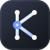
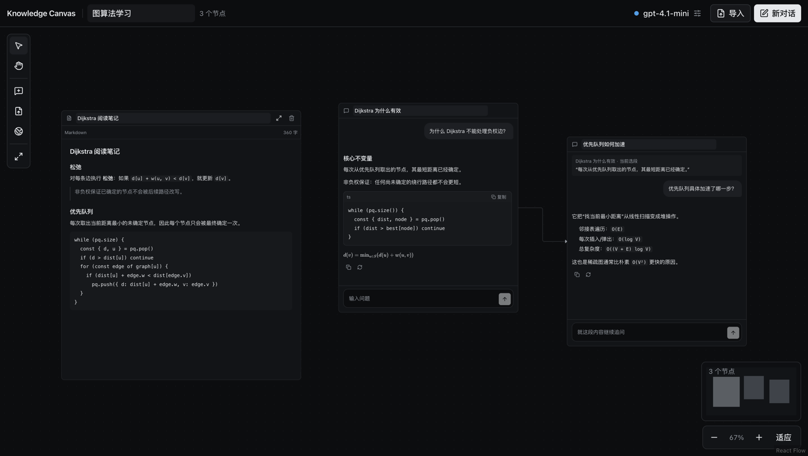
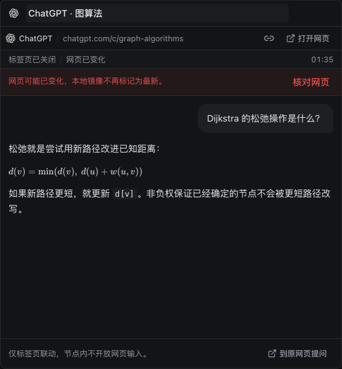
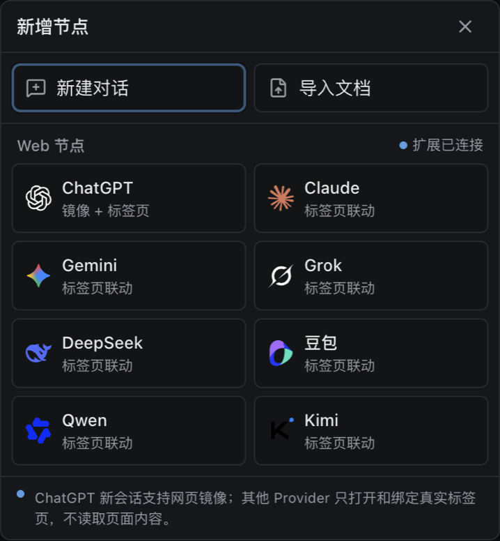
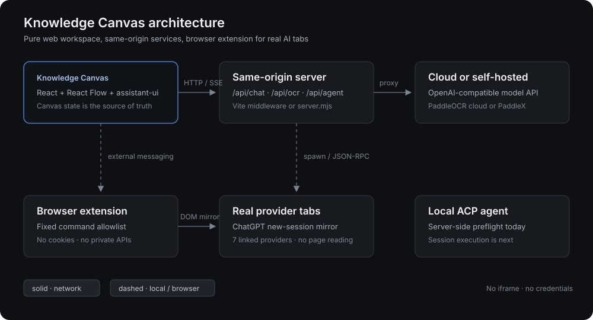

<div align="center">



# Knowledge Canvas

**An open-source, local-first AI learning workspace built on an infinite canvas.**

Keep conversations, papers, OCR text, and live AI web sessions in one spatial workspace. Select a passage, branch from its source, and preserve the reasoning path instead of losing it in a linear chat list.

[](./LICENSE)
[](https://github.com/LaplaceYoung/knowledge-canvas/actions/workflows/ci.yml)
[](#project-status)
[](https://www.typescriptlang.org/)
[](https://react.dev/)
[](https://www.assistant-ui.com/)
[](https://www.paddleocr.ai/)
[](#contributing)
[](https://github.com/LaplaceYoung/knowledge-canvas/stargazers)

[Quick start](#quick-start) · [Features](#features) · [Architecture](#architecture) · [Web nodes](#web-nodes) · [Local agent](#local-agent-acp) · [FAQ](#faq) · [中文说明](./README.zh-CN.md) · [llms.txt](./llms.txt)

</div>



## Why Knowledge Canvas?

Most AI study sessions end up in a long scroll. The important part is not only the answer, but **where the question came from**, **which source it used**, and **which thread belongs next to it**.

Knowledge Canvas makes the source relationship spatial:

- Select text from an AI answer, PDF, Markdown, TXT, or OCR result.
- Create a follow-up node that keeps the quote and source visible.
- Let the next request inherit the upstream context.
- Keep side questions beside the main thread instead of replacing it.

It is a **pure web application**. No Electron, no Tauri, no local browser process hidden behind the UI.

## Features

| | |
|---|---|
| **Infinite canvas** | Pan, zoom, drag, resize, minimap, semantic zoom, and camera reveal with React Flow. |
| **Canvas sidebar** | Create, rename, pin, reorder, delete, and switch between multiple persisted canvases without leaving the workspace. |
| **Settings** | One panel for LLM keys, search keys (TinyFish, Exa, DeepSeek, Bocha), PaddleOCR, ACP agent, and reading size. |
| **Branching chat** | assistant-ui thread with streaming, stop, retry, copy, regenerate, Markdown, GFM, LaTeX, and code copy. |
| **Source-anchored branches** | Every follow-up keeps its quoted passage, parent message or page, and a return path to the source. |
| **Documents** | Read-only PDF, Markdown, and TXT nodes with text selection and local persistence. |
| **PaddleOCR** | Keep scanned PDFs, render pages locally, call PaddleOCR cloud or self-hosted PaddleX, and anchor recognized text to page numbers. |
| **Web nodes** | Bind real ChatGPT, Claude, Gemini, Grok, DeepSeek, Doubao, Qwen, or Kimi tabs through a browser extension. Prompt and read visible messages inside the node, with provider-specific model, thinking, and search controls. |
| **BYOK models** | OpenAI-compatible `/chat/completions` endpoints, including local model servers, through a same-origin proxy that avoids browser CORS failures. |
| **Node menu** | Double-click blank canvas space for New chat, Upload file, or Web node. Web node opens an official-logo provider submenu on hover. |
| **Dark, restrained UI** | shadcn/ui controls, assistant-ui primitives, hairline borders, one blue accent, and 12–20px reading text. |
| **Local-first storage** | Canvas state in local storage, PDF binaries in IndexedDB, API keys only in `sessionStorage`. |

## Screenshots

<table>
  <tr>
    <td width="50%">
      
      <br />
      <sub><strong>Web node</strong> — a real provider session with in-node prompting and controls.</sub>
    </td>
    <td width="50%">
      
      <br />
      <sub><strong>Provider menu</strong> — double-click blank canvas space to pick a node type.</sub>
    </td>
  </tr>
  <tr>
    <td colspan="2">
      
      <br />
      <sub><strong>Architecture</strong> — same-origin services plus explicit browser boundaries.</sub>
    </td>
  </tr>
</table>

## Quick start

Requirements: Node.js 20.19+ and npm.

```bash
git clone https://github.com/LaplaceYoung/knowledge-canvas.git
cd knowledge-canvas/app
npm install
npm run dev
```

Open <http://127.0.0.1:3000>.

For a production-style run:

```bash
cd app
npm run build
npm start
```

The included `server.mjs` serves the built app and the `/api/chat`, `/api/ocr`, and `/api/agent` routes. Default address: `http://127.0.0.1:4173`.

### Browser extension for Web nodes

```bash
# Chrome / Chromium
open chrome://extensions
```

1. Enable **Developer mode**.
2. Choose **Load unpacked** and select the [`extension/`](./extension) directory.
3. Return to the canvas and create a Web node.

The extension has a stable ID and only connects to local canvas origins by default. Add your production origin to `extension/manifest.json` before deploying elsewhere.

## Configuration

Open **Settings** from the sidebar gear or the top bar model button.

| Area | What you configure |
|---|---|
| **Model** | Base URL, model name, and optional API key. Supports OpenAI-compatible endpoints and local servers. |
| **Search** | Session keys for TinyFish, Exa, DeepSeek, and Bocha, plus the default search source. |
| **OCR** | PaddleOCR cloud (AI Studio token, PP-OCRv6 / PP-OCRv5) or a self-hosted PaddleX `/ocr` endpoint. |
| **Agent** | Read-only ACP preflight status. The agent command is configured on the server, never submitted by the browser. |
| **Display** | Reading font size from 12px to 20px with local persistence. |

Optional server environment:

```dotenv
# app/.env
PADDLEOCR_ACCESS_TOKEN=
PADDLEOCR_BASE_URL=https://paddleocr.aistudio-app.com

# Local ACP agent preflight only; not yet used as a chat backend.
KC_ACP_COMMAND=/absolute/path/to/acp-agent
KC_ACP_ARGS=[]
KC_ACP_CWD=/absolute/workspace/path
```

### Supported document formats

- PDF with an embedded text layer
- Scanned PDF through PaddleOCR
- Markdown and plain text

## Architecture

```text
Knowledge Canvas (browser) ── same-origin ──> server.mjs / Vite middleware
       │                                         ├─ /api/chat  → model provider
       │                                         ├─ /api/ocr   → PaddleOCR
       │                                         └─ /api/agent → local ACP preflight
       │
       └─ extension messaging ──> real provider tabs
```

The model and OCR requests go through a same-origin server instead of direct browser calls. That avoids third-party CORS failures and keeps provider credentials out of URLs and page requests.

The browser extension is intentionally narrow:

- fixed provider allowlist;
- fixed command allowlist;
- no cookie or token access;
- no private provider APIs;
- no arbitrary URL or CSS selector execution;
- no iframe embedding or security-header modification.

## Web nodes

A Web node is **not an iframe**. It is a canvas node bound to a real provider tab. Double-click blank canvas space to open the new-node menu; official provider marks are used for identification.

Supported providers: **ChatGPT, Claude, Gemini, Grok, DeepSeek, Doubao, Qwen, and Kimi**.

- **In-node prompting**: every bound provider submits through its normal webpage composer and mirrors the visible messages that appear after the prompt. This uses the webpage account and quota, not the BYOK key.
- **Provider controls**: the node discovers the model, thinking, and search controls that the page actually renders. DeepSeek exposes thinking and smart-search toggles; ChatGPT exposes thinking; Claude, Grok, Kimi, Gemini, and Doubao expose their current model menus when present.
- **Fallback**: without the extension, or when a provider page changes, the node remains a real-page shortcut. Lost bindings and unknown submit states are shown explicitly, never treated as success.

Every adapter is DOM-based and provider-specific. Live provider DOM changes can require selector updates. See [`extension/README.md`](./extension/README.md).

## Local Agent (ACP)

The Agent tab is a **connection preflight**, not a replacement for the normal chat backend.

It starts a server-configured ACP process, negotiates the protocol, creates a temporary session, reports capabilities, and exits. The browser cannot choose the command, arguments, or working directory.

The next integration step is per-node ACP sessions with explicit upstream increments, tool/permission events, cancellation, compaction, and cleanup. See the code in [`app/server/agent-bridge.mjs`](./app/server/agent-bridge.mjs).

## Security and privacy

- BYOK API keys stay in the current tab's `sessionStorage`.
- PaddleOCR tokens also stay in `sessionStorage`.
- The extension does not read, export, or persist cookies, authorization headers, or provider tokens.
- Canvas data and PDF binary data stay in the browser profile.
- A same-origin proxy does not make a public deployment safe by itself. Add authentication and rate limiting to `/api/*` before exposing it.
- “Local canvas” does not mean “local inference”: a configured cloud model or OCR provider still receives the submitted content.

## Project status

This is an early self-hosted build, not a finished SaaS product.

| Area | Status |
|---|---|
| Infinite canvas, chat branches, documents, OCR | Working MVP |
| PaddleOCR cloud + self-hosted adapters | Working against mocks and official API contract |
| Web node W0/W1/W2 | Working against Chrome live pages; provider selectors need continuous verification |
| Local ACP agent | Preflight only; session/chat execution is next |
| Cloud sync, accounts, sharing, collaboration | Not included |
| Desktop app | Intentionally not included |

## FAQ

<details>
<summary><strong>Is Knowledge Canvas a ChatGPT clone?</strong></summary>

No. It is a spatial learning workspace. Chat is one node type; PDFs, OCR text, and live web sessions live on the same canvas, and follow-ups preserve their source.

</details>

<details>
<summary><strong>Does it support scanned PDFs?</strong></summary>

Yes. A PDF without an embedded text layer is kept instead of rejected. OCR is explicit by default and can be enabled automatically for scanned imports. Results are stored per page and can be selected to create page-anchored branches.

</details>

<details>
<summary><strong>Can I use a local model server?</strong></summary>

Yes. Any OpenAI-compatible local endpoint works through the same-origin chat proxy. API keys are optional for local servers.

</details>

<details>
<summary><strong>Does the browser extension read my provider cookies?</strong></summary>

No. It operates on the real page DOM within the user's existing browser session for every supported provider. It never calls `chrome.cookies`, reads authorization headers, or uses private APIs.

</details>

<details>
<summary><strong>Why not embed the websites in an iframe?</strong></summary>

Provider pages commonly block framing with `X-Frame-Options` or CSP, and cross-origin iframes cannot expose their DOM to the canvas. The extension uses a real tab so login, CAPTCHA, and quotas remain in the provider page.

</details>

<details>
<summary><strong>Can I host this without a backend?</strong></summary>

The static canvas can load, but chat, OCR, and Agent preflight need the same-origin routes from `server.mjs` (or equivalent serverless functions). Do not expose those routes without access control.

</details>

## Contributing

Issues and pull requests are welcome. Before opening a PR:

```bash
cd app
npm run lint
npm run build
```

Keep provider-specific behavior behind adapters and document any capability that is not validated. Do not commit credentials, provider cookies, or unrelated product documents.

## License

MIT © LaplaceYoung. See [LICENSE](./LICENSE).

Provider names and marks are trademarks of their respective owners and are used only to identify the linked real web services. Logo assets are sourced from the MIT-licensed [LobeHub Icons](https://github.com/lobehub/lobe-icons) set; see [`app/THIRD_PARTY_NOTICES.md`](./app/THIRD_PARTY_NOTICES.md).

<div align="center">
<sub>Infinite canvas · AI learning · branching chat · PDF OCR · multi-provider web nodes · self-hosted</sub>
</div>
