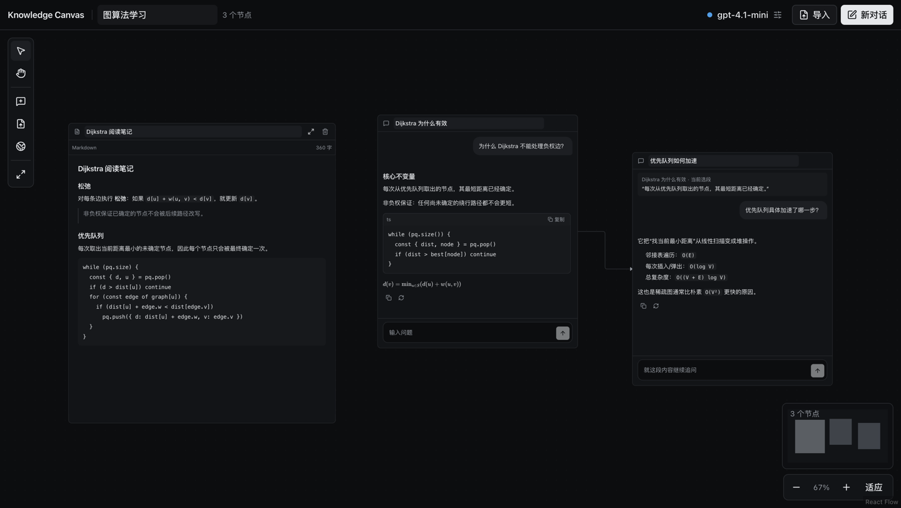
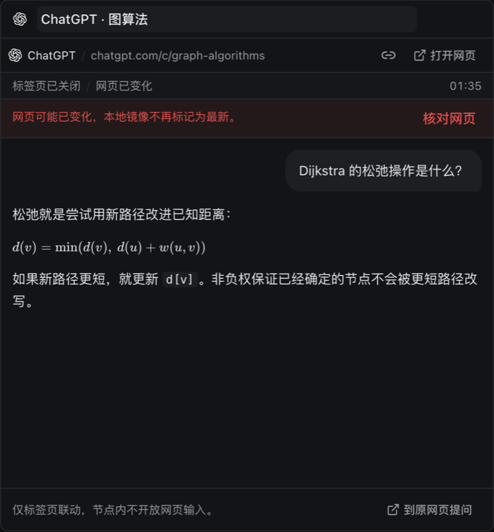
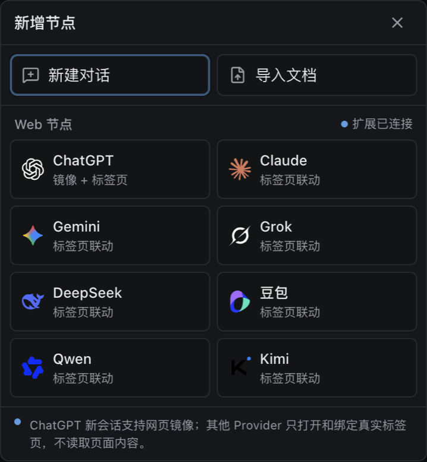
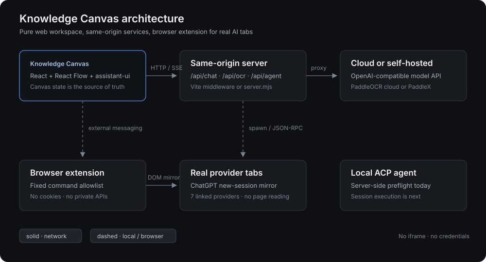

<div align="center">

# Knowledge Canvas

**开源、本地优先的 AI 学习工作台，以无限画布组织对话、文档、OCR 和真实网页会话。**

选中原文或 AI 回答中的一段，就地创建保留来源的追问分支。理解路径留在画布上，而不是沉到一条越来越长的聊天列表里。

[](./LICENSE)
[](https://github.com/LaplaceYoung/knowledge-canvas/actions/workflows/ci.yml)
[](#项目状态)
[](https://www.typescriptlang.org/)
[](https://react.dev/)
[](https://www.assistant-ui.com/)
[](https://www.paddleocr.ai/)
[](#参与贡献)

[快速开始](#快速开始) · [功能](#功能) · [架构](#架构) · [Web 节点](#web-节点) · [本机-agent](#本机-agent-acp) · [FAQ](#faq) · [English](./README.md) · [llms.txt](./llms.txt)

</div>



## 为什么做 Knowledge Canvas

普通 AI 对话很难回答三个问题：这个追问**从哪里来**、用了**哪些来源**、应该放在**理解的哪一步**。

Knowledge Canvas 把这些关系放进空间里：

- 从 AI 回答、PDF、Markdown、TXT 或 OCR 结果中选中一段文字；
- 创建保留原文引用和来源位置的下游对话节点；
- 下一轮自动继承上游上下文；
- 支线放在主线旁边，不打断当前阅读。

它是**纯 Web 应用**，不是 Electron 或 Tauri 桌面套壳。

## 功能

| | |
|---|---|
| **无限画布** | React Flow 平移、缩放、拖动、调整大小、minimap、三级语义缩放和相机定位。 |
| **分支对话** | assistant-ui 线程、流式输出、停止、重试、复制、重新生成、Markdown、GFM、LaTeX 和代码复制。 |
| **来源锚点** | 每个追问保留引用文本、父消息或页码，可回到原文并恢复高亮。 |
| **文档阅读** | PDF、Markdown、TXT 只读节点，支持文本选择与本地保存。 |
| **PaddleOCR** | 保留扫描 PDF，在浏览器逐页渲染，通过云端或自建 PaddleX 识别，并按页保存。 |
| **Web 节点** | 通过浏览器扩展绑定真实 ChatGPT、Claude、Gemini、Grok、DeepSeek、豆包、Qwen、Kimi 标签页；节点内提问、读取可见消息，并按网页能力调整模型、思考与联网控制。 |
| **BYOK 模型** | 任意 OpenAI-compatible `/chat/completions` 接口，经同源代理调用，避免浏览器 CORS 失败。 |
| **新增节点菜单** | 双击画布空白处，从带官方 logo 的菜单连接 Web Provider；新建对话和导入文档保留在顶栏。 |
| **深色阅读界面** | shadcn/ui + assistant-ui，细边框、单一蓝色强调色，正文 12–20px 可调。 |
| **本地优先存储** | 画布在 localStorage，PDF 二进制在 IndexedDB，密钥只在 `sessionStorage`。 |

## 截图

<table>
  <tr>
    <td width="50%">
      
      <br />
      <sub><strong>Web 节点</strong> — 真实网页会话、节点内提问与 Provider 控制项。</sub>
    </td>
    <td width="50%">
      
      <br />
      <sub><strong>新增节点菜单</strong> — 双击画布空白处选择节点类型。</sub>
    </td>
  </tr>
  <tr>
    <td colspan="2">
      
      <br />
      <sub><strong>架构</strong> — 同源服务与明确的浏览器边界。</sub>
    </td>
  </tr>
</table>

## 快速开始

要求：Node.js 20.19+ 与 npm。

```bash
git clone https://github.com/LaplaceYoung/knowledge-canvas.git
cd knowledge-canvas/app
npm install
npm run dev
```

打开 <http://127.0.0.1:3000>。

生产模式：

```bash
cd app
npm run build
npm start
```

`server.mjs` 同时提供静态页面和 `/api/chat`、`/api/ocr`、`/api/agent` 路由，默认地址为 `http://127.0.0.1:4173`。

### 安装 Web 节点扩展

1. 打开 `chrome://extensions`；
2. 启用开发者模式；
3. 选择“加载已解压的扩展程序”，指向仓库里的 [`extension/`](./extension) 目录；
4. 回到画布创建 Web 节点。

扩展默认只允许本地画布 origin 连接。部署到正式域名前，需要修改 `extension/manifest.json` 的 `externally_connectable`。

## 配置

在画布右上角打开“工作区设置”。

| 区域 | 内容 |
|---|---|
| **模型** | Base URL、模型名、可选 API Key；支持 OpenAI-compatible 接口和本机模型服务。 |
| **OCR** | PaddleOCR 云端（AI Studio Token、PP-OCRv6 / PP-OCRv5）或自建 PaddleX `/ocr`。 |
| **Agent** | ACP 本机 Agent 预检；命令只允许在服务端配置。 |
| **显示** | 正文字号 12–20px，本地持久化。 |

可选服务端变量：

```dotenv
PADDLEOCR_ACCESS_TOKEN=
PADDLEOCR_BASE_URL=https://paddleocr.aistudio-app.com

# 仅用于本机 ACP Agent 预检，尚未作为聊天执行后端。
KC_ACP_COMMAND=/absolute/path/to/acp-agent
KC_ACP_ARGS=[]
KC_ACP_CWD=/absolute/workspace/path
```

支持 PDF（带文本层）、扫描 PDF（PaddleOCR）、Markdown、TXT。

## 架构

```text
Knowledge Canvas（浏览器） ── 同源 HTTP/SSE ──> server.mjs / Vite 中间件
       │                                            ├─ /api/chat  → 模型 Provider
       │                                            ├─ /api/ocr   → PaddleOCR
       │                                            └─ /api/agent → 本机 ACP 预检
       │
       └─ 扩展消息桥 ──> 真实 Provider 标签页
```

模型和 OCR 请求经同源服务转发，避免第三方 CORS 拦截，也避免把凭据放进页面 URL。

浏览器扩展遵循最小权限：

- Provider allowlist；
- 固定命令 allowlist；
- 不读取 Cookie 或网页 token；
- 不调用私有 API；
- 不接受任意 URL、脚本或 CSS selector；
- 不通过 iframe 或修改安全响应头绕过站点边界。

## Web 节点

Web 节点不是 iframe，而是绑定真实网页标签页的画布节点。双击画布空白处打开新增节点菜单，Provider 使用官方品牌 logo 标识。

支持的 Provider：**ChatGPT、Claude、Gemini、Grok、DeepSeek、豆包、Qwen、Kimi**。

- **节点内提问**：所有已绑定 Provider 都通过真实网页输入框提交，只镜像提交后出现的可见消息。使用网页账户与额度，不调用 BYOK Key。
- **Provider 控制项**：节点读取网页实际渲染的模型、思考与搜索控件。DeepSeek 暴露深度思考和智能搜索开关；ChatGPT 暴露思考开关；Claude、Grok、Kimi、Gemini、豆包在页面提供时暴露当前模型菜单。
- **降级**：未安装扩展、页面变化或绑定失效时，节点退回真实网页入口；提交未知状态不会被假装成成功。

每个适配器都依赖具体 DOM，Provider 页面改版可能导致选择器失效。详见 [`extension/README.md`](./extension/README.md)。

## 本机 Agent (ACP)

Agent 标签目前是**连接预检**，不是普通对话的替代后端。

服务端启动一次 ACP 进程，完成 `initialize` 和临时 `session/new`，返回 Agent 信息、协议版本、认证方式与能力，然后退出。浏览器不能提交任意命令、参数或工作目录。

下一阶段才是每节点独立 session、祖先增量、工具/权限事件、取消、压缩与进程清理。实现见 [`app/server/agent-bridge.mjs`](./app/server/agent-bridge.mjs)。

## 安全与隐私

- BYOK API Key 只保存在当前标签页 `sessionStorage`。
- PaddleOCR Token 同样只保存在 `sessionStorage`。
- 扩展不读取、导出或持久化 Cookie、Authorization header、网页 token。
- 画布内容和 PDF 二进制保存在当前浏览器 Profile。
- 同源代理不等于公网安全。部署到公网前必须给 `/api/*` 增加鉴权和限流。
- “本机画布”不代表“本地推理”：调用云端模型或 OCR 时，内容仍会发送给对应服务。

## 项目状态

这是早期自托管版本，不是完成态 SaaS。

| 模块 | 状态 |
|---|---|
| 无限画布、对话分支、文档、OCR | MVP 可用 |
| PaddleOCR 云端 / 自建适配 | 已按官方合约和 mock 验证 |
| Web 节点 W0/W1/W2 | Chrome 真实页面已验证；Provider 选择器需持续验证 |
| 本机 ACP Agent | 预检可用；会话执行待开发 |
| 云同步、账号、分享、协作 | 不包含 |
| 桌面 App | 明确不做 |

## FAQ

<details>
<summary><strong>Knowledge Canvas 和 ChatGPT 有什么区别？</strong></summary>

它不是一个线性聊天网站，而是空间化学习工作台。对话、PDF、OCR 文本和真实网页会话可以放在同一块画布上，追问会保留来源。

</details>

<details>
<summary><strong>支持扫描版 PDF 吗？</strong></summary>

支持。没有文本层的 PDF 不会被丢弃，可以手动或自动运行 PaddleOCR，识别结果按页保存，并可直接选中创建带页码的分支。

</details>

<details>
<summary><strong>可以使用本机模型吗？</strong></summary>

可以。任意 OpenAI-compatible 本地接口都能通过同源代理接入；本地服务可以留空 API Key。

</details>

<details>
<summary><strong>扩展会读取我的 Provider Cookie 吗？</strong></summary>

不会。扩展只在真实页面 DOM 中执行固定操作，所有 Provider 都不调用 `chrome.cookies`，不读取凭据，也不调用私有 API。

</details>

<details>
<summary><strong>为什么不用 iframe？</strong></summary>

多数 AI 站点通过 `X-Frame-Options` 或 CSP 阻止嵌入，跨源 iframe 也无法让画布读取 DOM。扩展使用真实标签页，让登录、验证码和额度留在 Provider 页面内。

</details>

<details>
<summary><strong>可以只部署静态文件吗？</strong></summary>

画布静态页面可以加载，但聊天、OCR、Agent 预检依赖同源服务。需要部署 `server.mjs` 或等价的 Serverless/API 路由，并做好访问控制。

</details>

## 参与贡献

欢迎 Issue 和 PR。提交前请运行：

```bash
cd app
npm run lint
npm run build
```

Provider 特有逻辑请放在适配器后，尚未验证的能力要明确标注。不要提交凭据、Cookie 或无关的内部文档。

## License

MIT © LaplaceYoung，见 [LICENSE](./LICENSE)。

Provider 名称与商标归各自所有者，仅用于标识被联动的真实网页服务。Logo 资源来自 MIT 许可的 [LobeHub Icons](https://github.com/lobehub/lobe-icons)，见 [`app/THIRD_PARTY_NOTICES.md`](./app/THIRD_PARTY_NOTICES.md)。

<div align="center">
<sub>无限画布 · AI 学习 · 分支对话 · PDF OCR · 多 Provider Web 节点 · 自托管</sub>
</div>
